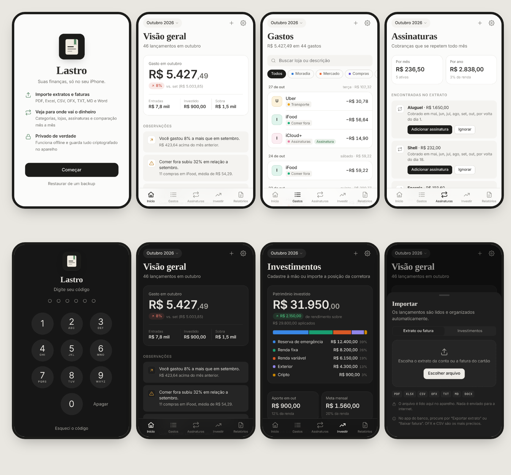

# Lastro — finanças pessoais

App de finanças para iPhone que funciona **offline** e guarda tudo **criptografado no próprio aparelho**.
Visual inspirado em Notion e Obsidian, com modo claro e escuro.



## O que faz

- **Importa extratos e faturas**: PDF, Excel (XLSX/XLS/ODS), CSV, OFX, TXT, Markdown e Word (DOCX). PDFs com senha pedem a senha.
- **Organiza sozinho**: reconhece mais de 100 lojas e serviços brasileiros (iFood, Uber, Pão de Açúcar, Netflix…), separa gastos, entradas, aplicações e pagamentos de fatura, e ignora lançamentos repetidos.
- **Aprende com você**: ao trocar a categoria de um lançamento, todos os da mesma loja mudam junto e os próximos seguem a regra.
- **Relatório do mês**: total gasto, comparação com o mês anterior, categorias, lojas, não identificados e observações.
- **Assinaturas**: encontra cobranças de mesmo valor em meses seguidos e pergunta se quer registrar. Mostra o total por mês e por ano e se cada uma já foi paga no mês.
- **Investimentos**: cadastro manual ou importação da planilha da corretora, alocação, rendimento, reserva de emergência e sugestões.
- **Exporta** PDF, planilha XLSX, CSV e Markdown pronto para o Obsidian (com frontmatter e tabelas). A planilha exportada pode ser importada de volta.

## Segurança

- Dados cifrados com **AES-256-GCM** no IndexedDB do aparelho. Nada é enviado para servidores; não existe servidor.
- Abre com **código de 6 dígitos** ou **Face ID** (WebAuthn). No iOS 18+ a chave de criptografia é derivada do próprio Face ID (extensão PRF).
- **Esqueci o código**: entre com Face ID (se o rosto falhar, o iPhone pede o código do aparelho) ou com a **chave de recuperação** de 20 caracteres mostrada na criação. Depois é só criar um código novo.
- Bloqueio automático ao sair do app (na hora, 1 ou 5 minutos), conteúdo borrado no seletor de apps e espera crescente após 5 códigos errados.
- **Backup criptografado** (.lastro) para guardar no iCloud Drive; só abre com o seu código.

## Instalar no iPhone

O Lastro é um web app instalável (PWA). Ele precisa estar publicado num endereço HTTPS uma vez; depois de instalado, roda sem internet.

1. Publique a pasta com GitHub Pages: no GitHub, **Settings → Pages → Build and deployment → Deploy from a branch**, escolha o branch e a pasta `/ (root)`. O endereço fica `https://<usuário>.github.io/<repositório>/`.
2. No iPhone, abra esse endereço no **Safari**.
3. Toque em **Compartilhar → Adicionar à Tela de Início**.
4. Abra pelo ícone, crie o código e guarde a chave de recuperação.

O site publicado contém apenas o código do app. Seus extratos e números nunca saem do iPhone.

## Testar no computador

```bash
python3 -m http.server 8000
# http://localhost:8000          → fluxo normal
# http://localhost:8000/?demo    → cofre de teste com código 123456 e dados de exemplo (só em localhost)
```

## Estrutura

| Arquivo | Função |
|---|---|
| `js/vault.js` | Criptografia, código, Face ID, chave de recuperação, backup |
| `js/parsers.js` | Leitura de PDF, planilhas, CSV, OFX, TXT, MD e DOCX |
| `js/categorize.js` | Limpeza da descrição, lojas conhecidas, categorias e regras |
| `js/analysis.js` | Resumo do mês, comparação, assinaturas recorrentes, observações |
| `js/exports.js` | Markdown, CSV, XLSX e PDF |
| `js/app.js` | Telas e navegação |
| `sw.js` | Cache offline (troque `VERSION` a cada nova versão) |
| `vendor/` | Bibliotecas de terceiros, incluídas para funcionar offline |
