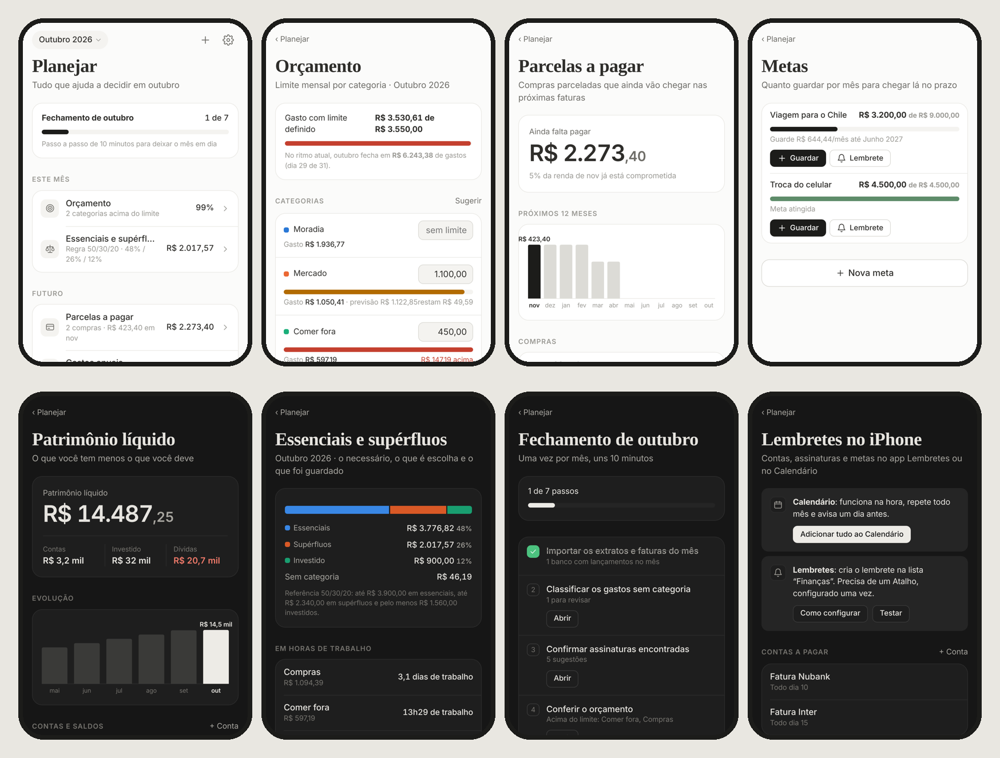

# Lastro — finanças pessoais

> Este repositório também tem a **Máquina de Roteiro**, app para escrever roteiros de vídeo, na pasta [`roteiro/`](roteiro/README.md): https://arthurcsanti.github.io/desktop-tutorial/roteiro/

App de finanças para iPhone que funciona **offline** e guarda tudo **criptografado no próprio aparelho**.
Visual inspirado em Notion e Obsidian, com modo claro e escuro.




## O que faz

- **Importa extratos e faturas**: PDF, Excel (XLSX/XLS/ODS), CSV, OFX, TXT, Markdown e Word (DOCX). PDFs com senha pedem a senha. Dá para escolher **vários arquivos de uma vez** ou um **.zip** com os extratos de vários bancos.
- **Bancos testados com os formatos de exportação**: Nubank (conta e fatura), Inter (extrato e fatura), Itaú, Santander, Mercado Pago e XP (fatura e posição de investimentos). O banco de origem é reconhecido automaticamente.
- **Transferências entre suas contas** (PIX do Nubank para o Inter, por exemplo) não contam como gasto nem renda: basta informar seu nome em Ajustes. Pagamento de fatura, caixinhas/porquinhos e resgates também ficam de fora dos gastos.
- **Organiza sozinho**: reconhece mais de 100 lojas e serviços brasileiros (iFood, Uber, Pão de Açúcar, Netflix…), separa gastos, entradas, aplicações e pagamentos de fatura, e ignora lançamentos repetidos.
- **Aprende com você**: ao trocar a categoria de um lançamento, todos os da mesma loja mudam junto e os próximos seguem a regra.
- **Relatório do mês**: total gasto, comparação com o mês anterior, categorias, lojas, não identificados e observações.
- **Assinaturas**: encontra cobranças de mesmo valor em meses seguidos e pergunta se quer registrar. Mostra o total por mês e por ano e se cada uma já foi paga no mês.
- **Investimentos**: cadastro manual ou importação da planilha da corretora, alocação, rendimento, reserva de emergência e sugestões.
- **Exporta** PDF, planilha XLSX, CSV e Markdown pronto para o Obsidian (com frontmatter e tabelas). A planilha exportada pode ser importada de volta.

## Planejar

- **Fechamento do mês guiado**: 7 passos (importar todos os bancos, classificar, confirmar assinaturas, conferir orçamento, atualizar saldos, guardar para as metas, salvar no Obsidian), marcados sozinhos conforme você avança.
- **Orçamento por categoria** com aviso a partir de 80%, previsão de fechamento do mês pelo ritmo atual e sugestão de limites pela média dos últimos 3 meses.
- **Essenciais e supérfluos** (regra 50/30/20). Você escolhe o que é essencial; a reserva de emergência passa a usar só esses gastos.
- **Custo em horas de trabalho** em cada gasto, assinatura e categoria (renda média ÷ horas por mês).
- **Parcelas a pagar**: reconhece “LOJA 03/10” e “Parcela 3 de 10” e mostra quanto da renda dos próximos 12 meses já está comprometida.
- **Gastos anuais** (IPVA, IPTU, seguro…): quanto separar por mês, aviso no mês anterior e detecção no extrato.
- **Metas com prazo**: quanto guardar por mês, registro dos valores guardados.
- **Patrimônio líquido**: contas + investimentos − dívidas − parcelas futuras, com evolução mês a mês.
- **Juros e tarifas do ano** (IOF, anuidade, tarifas, juros), por mês e comparado ao ano anterior.
- **Etiquetas e reembolsos**: #viagem-floripa para somar um evento; PIX devolvido por um amigo abate o gasto em vez de contar como renda.
- **Rendimento vs. CDI e IPCA**: % do CDI e ganho real de cada investimento e da carteira. As taxas podem ser digitadas ou buscadas na API pública do Banco Central (só a taxa é consultada; nenhum dado seu sai do aparelho).
- **Imposto de Renda**: rendimentos, despesas médicas e de educação, PGBL e bens e direitos do ano, exportáveis em Markdown e CSV.
- **Lembretes no iPhone**: botão “Calendário” gera eventos que se repetem com alerta (arquivo .ics) e botão “Lembrete” cria no app Lembretes pelo Atalho “Lastro Lembrete” (passo a passo dentro do app). Vale para assinaturas, contas a pagar, gastos anuais, metas e o fechamento do mês.

## Segurança

- Dados cifrados com **AES-256-GCM** no IndexedDB do aparelho. Não existe servidor do app: nada sai do aparelho, a não ser o backup cifrado no seu Google Drive, se você ligar.
- Abre com **código de 6 dígitos** ou **Face ID** (WebAuthn). No iOS 18+ a chave de criptografia é derivada do próprio Face ID (extensão PRF).
- **Esqueci o código**: entre com Face ID (se o rosto falhar, o iPhone pede o código do aparelho) ou com a **chave de recuperação** de 20 caracteres mostrada na criação. Depois é só criar um código novo.
- Bloqueio automático ao sair do app (na hora, 1 ou 5 minutos), conteúdo borrado no seletor de apps e espera crescente após 5 códigos errados.
- **Backup criptografado** (.lastro) para guardar no iCloud Drive; só abre com o seu código.
- **Backup no Google Drive** (opcional, em Ajustes → Backup e atualização):
  - envia o mesmo backup **cifrado** para a pasta `Lastro/Backups` do seu Drive; o Google só guarda dados embaralhados;
  - conectado, faz backup sozinho uma vez por dia e depois de cada importação, e guarda os 15 mais recentes;
  - **para restaurar** num celular novo, use "Restaurar do Google Drive" na tela de boas-vindas e depois o código daquele backup;
  - usa o mesmo ID do cliente do Google do Máquina de Roteiro (o app reaproveita sozinho se ele já estiver salvo) e só enxerga os arquivos que ele mesmo criou.
- **Atualizar o aplicativo** (Ajustes): busca a versão mais nova publicada sem mexer nos dados.

## Instalar no iPhone

O Lastro é um web app instalável (PWA). Ele precisa estar publicado num endereço HTTPS uma vez; depois de instalado, roda sem internet.

1. Publique a pasta com GitHub Pages: no GitHub, **Settings → Pages → Build and deployment → Deploy from a branch**, escolha o branch e a pasta `/ (root)`. O endereço fica `https://<usuário>.github.io/<repositório>/`.
2. No iPhone, abra esse endereço no **Safari**.
3. Toque em **Compartilhar → Adicionar à Tela de Início**.
4. Abra pelo ícone, crie o código e guarde a chave de recuperação.

O site publicado contém apenas o código do app. Seus extratos e números nunca saem do iPhone.

## Testar no computador

```bash
python3 -m http.server 8000
# http://localhost:8000          → fluxo normal
# http://localhost:8000/?demo    → cofre de teste com código 123456 e dados de exemplo (só em localhost)
```

## Estrutura

| Arquivo | Função |
|---|---|
| `js/vault.js` | Criptografia, código, Face ID, chave de recuperação, backup |
| `js/parsers.js` | Leitura de PDF, planilhas, CSV, OFX, TXT, MD e DOCX |
| `js/categorize.js` | Limpeza da descrição, lojas conhecidas, categorias e regras |
| `js/analysis.js` | Resumo do mês, comparação, assinaturas recorrentes, observações |
| `js/exports.js` | Markdown, CSV, XLSX e PDF |
| `js/plan.js` | Parcelas, orçamento, 50/30/20, horas, tarifas, anuais, metas, patrimônio, CDI/IPCA, IR, fechamento |
| `js/planviews.js` | Telas da aba Planejar |
| `js/reminders.js` | Lembretes (Atalhos) e Calendário (.ics) |
| `js/ui.js` | Ícones, formatação e componentes |
| `js/app.js` | Telas e navegação |
| `sw.js` | Cache offline (troque `VERSION` a cada nova versão) |
| `vendor/` | Bibliotecas de terceiros, incluídas para funcionar offline |
